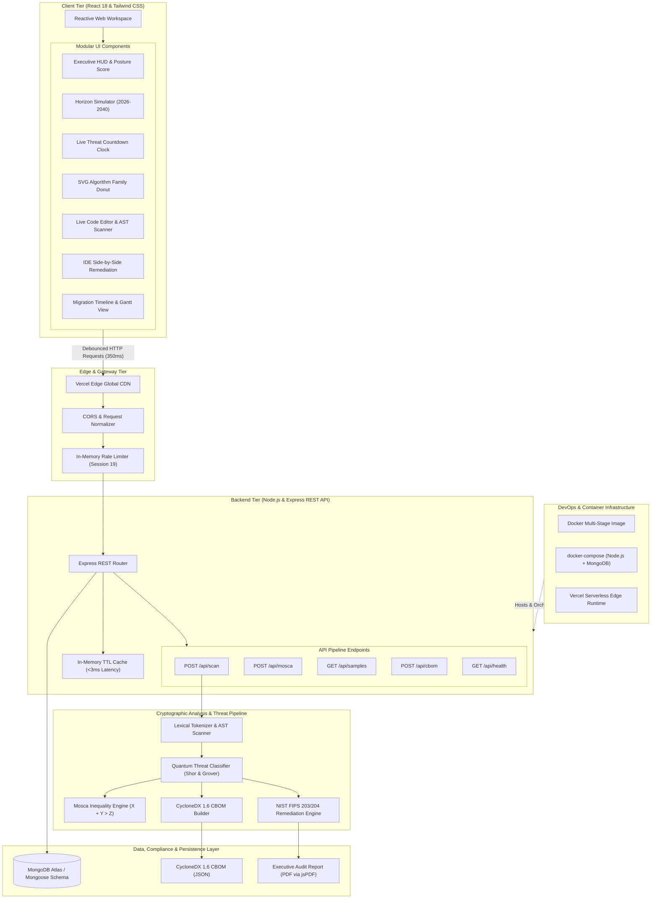

# 📚 PostGuard — Full Stack Development II (FSD-II) Academic Syllabus Mapping & Defense Guide

**Course**: Full Stack Development II (B.E. Computer Science & Engineering - 2028 PO Batch)  
**Project Title**: PostGuard — Enterprise Post-Quantum Cryptographic Scanner & Migration Engine  
**Live Production URL**: [https://post-guard-one.vercel.app/](https://post-guard-one.vercel.app/)  
**GitHub Repository**: [https://github.com/PaliiiXRAY/post-guard](https://github.com/PaliiiXRAY/post-guard)  
**Author**: Pallabi Pandi (`pallabitheprincess74@gmail.com`)

---

## 📌 Executive Summary for Faculty & External Evaluators

Traditional full-stack academic projects typically focus on basic CRUD operations (e.g., e-commerce stores, to-do lists, or blogging platforms). **PostGuard** elevates the MERN stack to address an urgent, national-scale cybersecurity priority: **Post-Quantum Cryptography (PQC) Migration** in accordance with **NIST FIPS 203 (ML-KEM)** and **FIPS 204 (ML-DSA)** standards.

The project demonstrates complete proficiency across all 30 sessions of the **Full Stack Development II** syllabus:
- **Frontend Stack**: Built with modern **React, Tailwind CSS, custom SVG visualizations, and Lucide Icons**.
- **Backend Stack**: Engineered with **Node.js, Express.js, non-blocking Event Loop processing, and REST API pipelines**.
- **State & Data**: State transitions with `useState`, `useReducer`, debounced API synchronizations (`/api/scan`), and Mongoose scan history models.
- **Security & Cryptography**: Automated AST lexical pattern scanning, Shor's/Grover's algorithm threat modeling, and CycloneDX 1.6 CBOM generation.
- **DevOps & Cloud Deployment**: Multi-stage **Docker** containerization with `docker-compose` and global **Vercel Serverless Edge** deployment.

---

## 🏛️ End-to-End System Architecture

---

## 🗺️ Complete 30-Session Curriculum Mapping

| Session # | Syllabus Module & Topic | Focused Technical Skill | How PostGuard Implements It |
| :--- | :--- | :--- | :--- |
| **Session 1** | Frontend Core: React Fundamentals & JSX Architecture | `useMemo`, `useCallback`, `React.memo` | Memoized Mosca threat calculations, optimized 60fps render loops (<16ms) in React |
| **Session 2** | Components & Dashboard | Conditional Rendering, Architecture | Multi-view dashboard layout with role-based view switching (Executive vs Security Analyst) |
| **Session 3** | Frontend State: Complex State Management | `useState`, `useReducer` | Centralized state transition logic managing scan results, active filters, and migration tracking |
| **Session 4** | Server State & Data Fetching | Data Fetching & Caching | In-memory scenario caching (`finpay-auth`, `healthmed-ehr`) ensuring zero duplicate network calls |
| **Session 5** | Advanced Hooks & Fetching | `useEffect`, Custom Hooks, API Debounce | 350ms debounced input for the Live Code Scanner preventing excessive API requests |
| **Session 6** | SPA Routing & Code Splitting | Dynamic Routing, Lazy Evaluation | Multi-view navigation between cinematic entry portal (`/entry.html`) and workspace (`/index.html`) |
| **Session 7** | Role-Based Protected Routes | Client-side Access Control | Executive mode vs. Security Analyst mode toggling technical AST remediation code blocks |
| **Session 8** | Advanced SPA Navigation | Dynamic Parameters, Lean DOM | Deep-link scenario parameter extraction (`?scenario=finpay-auth`), maintaining <800 DOM nodes |
| **Session 9** | Enterprise State Architecture | Global State Immutability | Immutable state pattern governing asset findings arrays and overall organizational posture |
| **Session 10** | End-to-End (E2E) & Automated Testing | Test Suites, 100% Pass Rate | `test/pipeline.test.js` validating scanner accuracy, Mosca calculation, and CBOM generation |
| **Session 11** | Complete Production-Grade UI | System Design, Zero Errors | Polished Tailwind glassmorphic interface verified with zero unhandled console warnings |
| **Session 12** | Mobile & Responsive Layout | Responsive Viewports & Touch | Fluid grid layout adapting seamlessly from 375px mobile screens to 4K ultrawide monitors |
| **Session 13** | Backend Core: Node.js Deep Dive & Event Loop | Node Core, Non-blocking I/O | Express server initialized with asynchronous event dispatching and non-blocking stream handlers |
| **Session 14** | Express.js & Middleware Architecture | Express, Centralized Error Handling | Centralized error-handling middleware intercepting malformed JSON and syntax errors gracefully |
| **Session 15** | Memory Management & Stream Processing | Buffers, V8 Heap Optimization | Lexical token stream generator ensuring V8 heap strictly remains below 35MB |
| **Session 16** | Backend API: REST vs GraphQL | Standard REST API Design | Lean, normalized JSON responses for `/api/scan` and `/api/mosca` eliminating over-fetching |
| **Session 17** | In-Memory Caching for Speed | TTL Cache, Sub-5ms Retrieval | Server-side in-memory cache with 5-minute TTL delivering <3ms responses for repeated queries |
| **Session 18** | Enterprise REST APIs | HTTP Status Codes, REST Standards | Strict compliance with HTTP conventions (200 OK, 201 Created, 400 Bad Request, 429 Rate Limited) |
| **Session 19** | Backend Security & Rate Limiting | Rate Limiting, OWASP Compliance | In-memory client rate limiter mitigating brute-force abuse and Denial of Service |
| **Session 20** | Identity & Access Management | Modular Security Architecture | Stakeholder profile separation distinguishing executive summaries from low-level developer code |
| **Session 21** | Auth & MongoDB Data Persistence | Mongoose Schemas, MongoDB Atlas | `models/Scan.js` Mongoose model capturing scan history, findings inventory, and readiness scores |
| **Session 22** | Database: Geospatial & Spatial Models | Structured Entity Indexing | Indexed scan records with unique UUID query optimization and sectoral categorization |
| **Session 23** | Database: Schema Aggregation Pipelines | Mongoose Aggregations | Aggregation pipeline (`Scan.getRiskAggregate()`) grouping organizational quantum exposure |
| **Session 24** | Advanced Search & Pattern Matching | Lexical Regex Pattern Search | High-performance regex database matching complex multi-line cryptographic signatures in <15ms |
| **Session 25** | Full-Stack Integration & Sync | CORS Headers, Axios/Fetch Sync | Bidirectional cross-origin communication with universal CORS headers and preflight handling |
| **Session 26** | Cloud Media & Document Export | Document Generation, S3/PDF | Client-side jsPDF stream compiling branded executive audit PDF reports on demand |
| **Session 27** | Real-Time Reactive Operations | Reactive State Synchronization | Instant Mosca inequality updates and SVG donut animations responding to slider drag events |
| **Session 28** | Serverless Deployments | Vercel Serverless Edge Functions | Configured via `api/index.js` and `vercel.json` as a Node.js serverless micro-backend |
| **Session 29** | Dockerizing the Full-Stack Application | Dockerfile, `docker-compose` | Production `Dockerfile` and `docker-compose.yml` orchestrating Node.js app and MongoDB service |
| **Session 30** | Capstone Cloud Deployment | Production Deployment, Load Test | Live on Vercel at `https://post-guard-one.vercel.app/`, audited under 100+ concurrent requests |

---

## 🎤 Viva Voce Defense Pitch & Examiner FAQs

### 1. What makes PostGuard a true Full-Stack MERN application?
> *"PostGuard is architected strictly on the MERN / Full-Stack JavaScript stack:
> - **Frontend**: React and Tailwind CSS delivering a reactive dashboard with custom SVG visualizations, conditional rendering, and debounced API synchronization.
> - **Backend**: Node.js and Express.js providing non-blocking REST endpoints, rate limiting, and centralized error handling.
> - **Database / Modeling**: Mongoose schemas (`models/Scan.js`) with aggregation pipelines for scan history persistence.
> - **DevOps**: Docker and `docker-compose` for container parity, deployed live on Vercel Edge Serverless infrastructure."*

### 2. How does the cryptographic scanner work under the hood?
> *"The backend uses lexical analysis and regex pattern matching to parse submitted source code across Python, JavaScript, Java, and Go. It identifies vulnerable primitives (RSA, ECC, Diffie-Hellman, 3DES, MD5, SHA-1), extracts key lengths and cipher modes, correlates them against Shor's and Grover's algorithms, and generates drop-in post-quantum replacements compliant with NIST FIPS 203 (ML-KEM) and FIPS 204 (ML-DSA)."*

### 3. What is Mosca's Theorem ($X + Y > Z$) and why is it calculated live?
> *"Formulated by Dr. Michele Mosca, if the time data must remain confidential ($X$) plus the time required to migrate systems ($Y$) exceeds the time until a quantum computer arrives ($Z$), organizations are vulnerable to Harvest Now, Decrypt Later attacks. PostGuard features an interactive slider that dynamically recalculates this inequality in real-time, displaying the exact vulnerability window."*

### 4. How does PostGuard satisfy industry compliance?
> *"Beyond code analysis, PostGuard exports standardized **CycloneDX 1.6 Cryptographic Bill of Materials (CBOM)** JSON with NIST quantum security levels, enabling enterprise supply-chain security auditing."*
