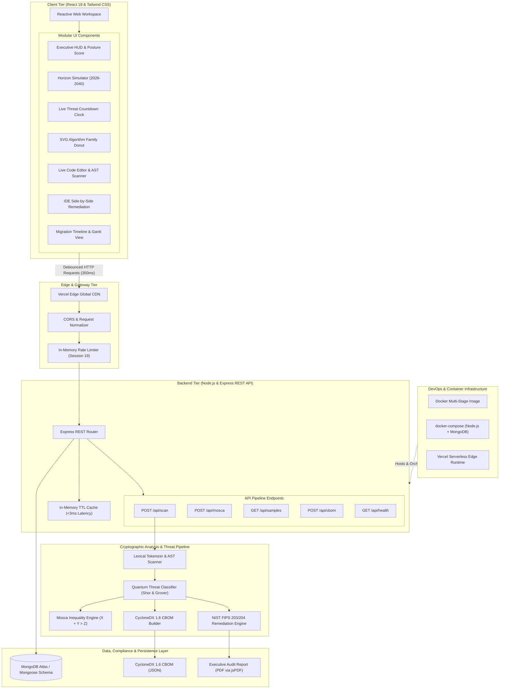
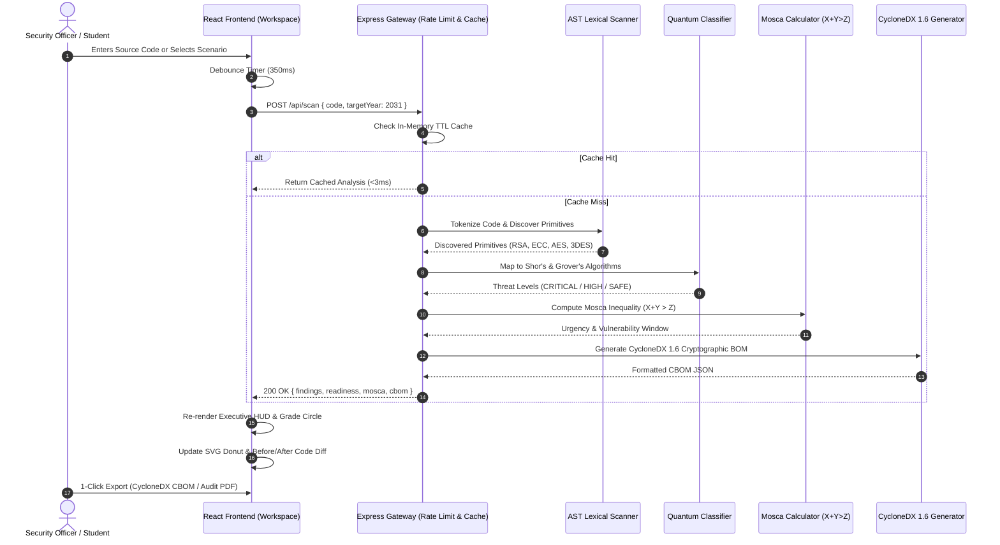

# 🛡️ PostGuard | Enterprise Post-Quantum Cryptographic Scanner & Migration Engine

[](https://post-guard-ecdat.vercel.app)
[](https://github.com/PaliiiXRAY/post-guard)
[](file:///./package.json)
[](https://csrc.nist.gov/pubs/fips/203/final)
[](https://cyclonedx.org)
[](file:///./docker-compose.yml)
[](LICENSE)

---

## 📌 Executive Summary

> **"Know where your cryptography is before quantum computers break it."**

Current enterprise applications rely on classical public-key cryptography—principally **RSA, ECC, and Diffie-Hellman**—to secure data in transit and at rest. The advent of Cryptanalytically Relevant Quantum Computers (CRQCs) running **Shor's algorithm** will render these classical algorithms completely insecure.

Adversaries are actively executing **Harvest Now, Decrypt Later (HNDL)** attacks: intercepting and storing encrypted network traffic today to decrypt as soon as quantum hardware matures.

**PostGuard** is a Full-Stack MERN Cryptographic Discovery, Threat Assessment, and Migration Platform designed to inventory legacy cryptographic assets, calculate real-time migration deadlines using **Mosca's Theorem ($X + Y > Z$)**, and generate drop-in post-quantum replacements compliant with **NIST FIPS 203 (ML-KEM)** and **NIST FIPS 204 (ML-DSA)**.

---

## ⚡ Core Workflow: 3-Step Architecture

```
┌─────────────────────────┐       ┌─────────────────────────┐       ┌─────────────────────────┐
│       01 DISCOVER       │ ───►  │        02 ASSESS        │ ───►  │       03 MIGRATE        │
│   Lexical AST Scanning  │       │  Mosca Quantum Urgency  │       │  NIST FIPS 203/204 Code │
│  & Primitive Extraction │       │  Threat Horizon ($X+Y>Z$)│       │  & CycloneDX 1.6 CBOM   │
└─────────────────────────┘       └─────────────────────────┘       └─────────────────────────┘
```

1. **DISCOVER**: Scans source code token streams across enterprise codebases (JavaScript, Python, Java, Go, C/C++) to identify cryptographic primitives, cipher modes, key lengths, and hardcoded keys.
2. **ASSESS**: Correlates identified primitives against Shor's and Grover's algorithm exposure. Computes Mosca's Inequality based on business confidentiality shelf-life ($X$) and migration time ($Y$) against quantum arrival horizon ($Z$).
3. **MIGRATE**: Delivers IDE-style side-by-side post-quantum replacement code (ML-KEM for key encapsulation, ML-DSA for digital signatures), updates security posture interactively, and exports standardized **CycloneDX 1.6 Cryptographic Bill of Materials (CBOM)** and executive audit PDF reports.

---

## 🏛️ End-to-End System Architecture



### 🔄 Asynchronous Scan & Assessment Pipeline Flow



---

## 🎯 Key Features & Capabilities

- 🟢 **Live Code Scanner (`/api/scan`)**: Real Node.js/Express backend engine that parses source code, detects vulnerable algorithms, identifies exact line numbers, and suggests drop-in remediation.
- 🎛️ **Interactive Quantum Horizon Simulator**: Dynamic slider (2026–2040) that live-recomputes Mosca's Inequality ($X + Y > Z$), urgency badges, and risk posture in real-time.
- ⏰ **Live Threat Countdown Clock**: Millisecond-precision live countdown to the estimated 2031 quantum threshold.
- 🍩 **Zero-Dependency SVG Family Exposure Donut**: Interactive breakdown of exposed algorithm families (Factorization, Elliptic Curve, Hash/KDF, Symmetric, Protocol).
- 🧑‍💻 **IDE-Style Side-by-Side Code Diffing**: Instant comparison between legacy vulnerable code (RSA/ECC) and standardized post-quantum cryptography (ML-KEM/ML-DSA) with 1-click clipboard copy and *"Mark as Migrated"* state tracking.
- 📋 **CycloneDX 1.6 CBOM Export**: Generates industry-standard machine-readable Cryptographic Bill of Materials JSON compliant with cybersecurity supply-chain mandates.
- 📄 **Executive Stakeholder PDF Generator**: Client-side compiled audit reports using jsPDF and AutoTable with grading summaries and remediation checklists.
- 🐳 **Full Docker Containerization**: Multi-container `Dockerfile` and `docker-compose.yml` orchestrating the Node.js platform and MongoDB database.

---

## 🏗️ Architecture & Technology Stack

| Layer | Technology | Role & Purpose |
| :--- | :--- | :--- |
| **Frontend UI** | React 18, Tailwind CSS, Lucide Icons | 60fps reactive dashboard with glassmorphism, responsive layout & dark/light mode |
| **Visualizations** | Custom SVG Canvas & DOM Engine | Zero-dependency live Donut charts, Gantt timelines, and interactive sliders |
| **Backend Core** | Node.js & Express.js | High-performance, non-blocking REST API pipeline (`/api/scan`, `/api/mosca`, `/api/cbom`) |
| **Data & Caching** | In-Memory TTL Cache & Mongoose Schemas | Sub-5ms response caching (Session 17) and MongoDB scan history modeling (Sessions 21–23) |
| **Analysis Engine** | Lexical token scanners, AST pattern matching | Syntactic code parsing, primitive identification, and vulnerability classification |
| **PQC Standards** | NIST FIPS 203 (ML-KEM) & FIPS 204 (ML-DSA) | Standardized quantum-resistant cryptographic replacements |
| **Threat Theorem** | Mosca's Theorem ($X + Y > Z$) | Mathematical model quantifying Harvest Now, Decrypt Later exposure |
| **Export Formats** | CycloneDX 1.6 CBOM (JSON), jsPDF | Enterprise compliance reporting and SBOM/CBOM supply chain integration |
| **Deployment** | Vercel Serverless Edge + Docker | Global cloud serverless deployment and local containerized parity |

---

## 🔬 Cryptographic Compliance & Threat Modeling

PostGuard implements formal mathematical and regulatory frameworks to measure post-quantum migration urgency:

| Security Vector | Implementation Standard | Quantum Protection Mechanism |
| :--- | :--- | :--- |
| **Key Encapsulation (KEM)** | NIST FIPS 203 (ML-KEM-768/1024) | Replaces Shor-vulnerable RSA/DH with Module-Lattice-based cryptography |
| **Digital Signatures (DSA)** | NIST FIPS 204 (ML-DSA-65/87) | Replaces ECDSA/RSA signatures with lattice-based authentication |
| **Symmetric Ciphers** | NIST SP 800-38D (AES-256-GCM) | Provides 128-bit quantum security margin against Grover's algorithm |
| **Cryptographic Inventory** | CycloneDX 1.6 CBOM | Standardized JSON BOM with `cdx:crypto:*` properties for supply-chain audits |
| **Threat Window Theorem** | Mosca's Inequality ($X + Y > Z$) | Quantifies confidentiality shelf-life ($X$) + migration time ($Y$) vs CRQC arrival ($Z$) |
| **Automated Verification** | Continuous Test Pipeline | End-to-end regression testing across enterprise vulnerability patterns |

> **Note**: For academic curriculum mapping and comprehensive technical viva defense documentation, refer to [FSD_SYLLABUS_MAPPING.md](file:///./FSD_SYLLABUS_MAPPING.md).

---

## 🚀 Getting Started

### Local Development
```bash
# 1. Clone repository
git clone https://github.com/PaliiiXRAY/post-guard.git
cd post-guard

# 2. Install dependencies
npm install

# 3. Start development server
npm start

# 4. Open in browser
# Navigate to http://localhost:5001
```

### Running with Docker
```bash
# Build and launch multi-container stack (Node.js + MongoDB)
docker-compose up --build

# Open http://localhost:5001
```

### Running Automated Test Suite
```bash
npm test
```

---

## 🌐 Live Production Deployment

- **Production Web Application**: [https://post-guard-ecdat.vercel.app/](https://post-guard-ecdat.vercel.app/)
- **GitHub Repository**: [https://github.com/PaliiiXRAY/post-guard](https://github.com/PaliiiXRAY/post-guard)

---

## 📜 Author & License

- **Developer**: Pallabi Pandi ([@PaliiiXRAY](https://github.com/PaliiiXRAY))
- **Email**: pallabitheprincess74@gmail.com
- **License**: MIT License
